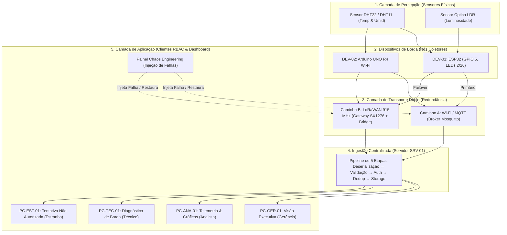

# Plataforma Resilient IoT & Oficina ESP32
### 23ª Semana Nacional de Ciência e Tecnologia (SNCT)
**Universidade Federal Rural de Pernambuco (UFRPE) · Unidade Acadêmica de Belo Jardim (UABJ)**  
*Engenharia da Computação — Laboratório de Sistemas Embarcados e Redes Conectadas*

---

## 📖 1. Visão Geral do Projeto

O **Resilient IoT** é um ecossistema educacional e experimental desenvolvido para demonstrar, na prática, conceitos de **alta disponibilidade, tolerância a falhas e arquiteturas multiprotocolo em Internet das Coisas (IoT)**.

O projeto foi projetado para a oficina prática da **Semana Nacional de Ciência e Tecnologia (SNCT)** e permite que estudantes, pesquisadores e entusiastas compreendam como sistemas críticos de monitoramento ambiental mantêm a integridade e entrega de dados mesmo diante de quedas de energia, atenuações severas de radiofrequência ou perda total de infraestrutura de rede.

---

## 🎯 2. Para Que Foi Desenvolvido

Em aplicações industriais, agrícolas e de cidades inteligentes, a perda de conectividade Wi-Fi ou a queda de um servidor broker MQTT não pode significar a perda irreversível de medições ambientais.

Este projeto foi construído para responder aos seguintes desafios de engenharia:
1. **Redundância de Transporte**: Como transitar automaticamente o envio de dados de uma rede primária de alta largura de banda (**Wi-Fi / MQTT**) para uma rede secundária de longo alcance e baixo consumo (**LoRaWAN 915 MHz**).
2. **Resiliência de Borda (*Store-and-Forward*)**: Como microcontroladores de baixo custo (ESP32 e Arduino) retêm telemetria em buffers locais durante um apagão total de comunicações (*Blackout*) e descarregam os dados ordenadamente assim que a rede se restabelece.
3. **Pipeline de Ingestão e Integridade**: Como um servidor central processa fluxos duplicados, valida integridade por hash e protege o acesso com perfis de autorização (RBAC).
4. **Chaos Engineering na Prática**: Como testar a resiliência de um sistema IoT injetando falhas deliberadas e controladas em tempo real durante uma aula expositiva.

---

## 🏛️ 3. Arquitetura do Sistema

O sistema é dividido em 5 camadas interconectadas:



---

## 💻 4. Ambientes em Que Pode Ser Implementado

O projeto foi concebido para funcionar tanto com **hardware real em bancada** quanto em **ambientes 100% virtuais**:

### A. Hardware Real com ESP32 Físico
* **Microcontrolador**: ESP32 NodeMCU / DevKit v1 (30 ou 38 pinos).
* **Sensor**: DHT22 (AM2302) ou DHT11 conectado no pino digital **GPIO 5**.
* **Atuadores**: LED no pino **GPIO 2** (Status MQTT) e **GPIO 26** (Atuador de telemetria).
* **Sketches disponíveis**:
  * `esp32_mqtt_dht22/esp32_mqtt_dht22.ino`: Comunicação direta com Broker MQTT (Mosquitto/HiveMQ).
  * `DHT22/DHT22.ino`: Servidor web integrado com endpoint JSON (`/dados`) e suporte a CORS para o Dashboard.

### B. Hardware Real com Arduino
* **Placa**: Arduino UNO R4 Wi-Fi ou Arduino UNO clássico com Shield Ethernet/LoRa.
* **Função**: Atua como nó secundário (`DEV-02`) para demonstrar redes heterogêneas.

### C. Simulação em Nuvem (Wokwi)
* Para quem não tem a placa física em mãos, os sketches podem ser executados no [Wokwi ESP32 Simulator](https://wokwi.com/).
* Configura-se o Wi-Fi para o SSID virtual `"Wokwi-GUEST"` e senha vazia `""`.

### D. Modo Autônomo da Dashboard Web
* A aplicação web localizada em `dashboard_resilient_iot/` possui um motor de simulação matemática em tempo real.
* Opera a 60 FPS com renderização em Canvas HTML5, sem exigir nenhuma dependência externa, compilador ou backend dedicado.

---

## 🎛️ 5. Funcionalidades da Aplicação Web

A aplicação web é uma **Single Page Application (SPA)** de alto desempenho construída em **HTML5, CSS3 puro (Design Mission Control) e JavaScript Vanilla**:

1. **Dashboard Principal (`#/dashboard`)**:
   * Cards de telemetria em tempo real: Temperatura (°C), Umidade (%), Luminosidade (Lux), Contadores de Pacotes, Taxa de Entrega (%) e Indicador de Saúde do Sistema.
   * **Topologia de Rede Animada**: Canvas interativo com partículas trafegando em tempo real pelos nós da rede. Nós e linhas mudam de cor dinamicamente conforme falhas ocorrem (Verde = Operacional, Vermelho = Offline/Falha, Âmbar = Contingência LoRa).
2. **Catálogo & Diagnóstico de Dispositivos (`#/devices` e `#/device/:id`)**:
   * Métricas detalhadas de `DEV-01` e `DEV-02`: buffers de Store-and-Forward (0 a 1000 pacotes), máquinas de estado (FSM: NORMAL ➔ FAILOVER ➔ BLACKOUT ➔ RECOVERING) e histórico de falhas de envio.
3. **Catálogo & Detalhes de Servidores (`#/servers` e `#/server/:id`)**:
   * Pipeline de ingestão de dados em 5 estágios com anel circular de aprovação SVG, deduplicação e taxas de rejeição por payload corrompido.
4. **Clientes de Aplicação com Controle de Acesso RBAC (`#/clients` e `#/client/:id`)**:
   * `PC-GER-01` (Gerência): Visão Executiva consolidada.
   * `PC-ANA-01` (Analista): Telemetria detalhada de todos os sensores.
   * `PC-TEC-01` (Técnico): Diagnóstico de hardware, integridade de buffers e FSM.
   * `PC-EST-01` (Estranho): Tela de bloqueio e Acesso Negado (HTTP 403 Forbidden).
5. **Painel Interativo de Chaos Engineering (`#/chaos`)**:
   * **Drawer lateral direito**: Permite injetar ao vivo cenários de *Tempestade* e *Blackout*, cortar ou restaurar o broker MQTT ou a rota LoRa, forçar overflow de buffer e observar em tempo real o failover automático e o descarregamento (*Flush*) dos dados represados.

---

## 📁 6. Estrutura do Repositório

```text
Oficina - ESP32/
├── README.md                              <- Este documento geral do projeto
├── PASSO_A_PASSO_EXECUCAO.md              <- Instruções completas para rodar e conectar
├── TABELA_DE_CONSULTA_MODIFICACOES.txt    <- Guia para quem nunca programou na vida
│
├── dashboard_resilient_iot/               <- Aplicação Web Front-End (SPA)
│   ├── index.html                         <- Interface gráfica e estruturas dos painéis
│   ├── style.css                          <- Design System escuro (Mission Control UI)
│   └── app.js                             <- Motor de simulação, Canvas, FSM e Chaos Engine
│
├── esp32_mqtt_dht22/                      <- Sketch ESP32 + Broker MQTT
│   └── esp32_mqtt_dht22.ino               <- Publicação em tópicos MQTT e controle de LEDs
│
├── DHT22/                                 <- Sketch ESP32 com Servidor Web integrado
│   └── DHT22.ino                          <- Web server local na porta 80 com API /dados
│
├── colocando_esp32_na_rede/               <- Exemplo básico de conexão Wi-Fi
├── conectando_esp32_ip_fixo/              <- Exemplo de configuração de IP estático
├── pratica1_leds/                         <- Prática introdutória de GPIO e atuadores
├── liga_ledLsimples/                      <- Acionamento simples de carga
└── led_liga_desafio/                      <- Desafio de lógica e temporização com LEDs
```

---

## 🎓 7. Créditos e Informações Acadêmicas

* **Instituição**: Universidade Federal Rural de Pernambuco (UFRPE)
* **Unidade**: Unidade Acadêmica de Belo Jardim (UABJ)
* **Curso**: Bacharelado em Engenharia da Computação
* **Evento**: 23ª Semana Nacional de Ciência e Tecnologia (SNCT)
* **Tema**: Internet das Coisas Resiliente, Tolerância a Falhas e Sistemas Embarcados
